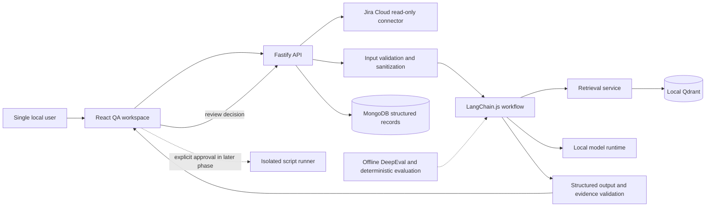
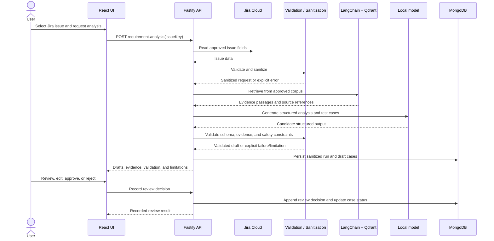
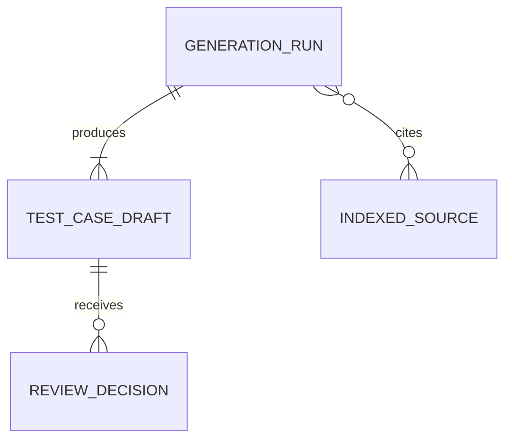

# Intelligent QA Workflow Assistant — Architecture

## 1. Purpose and status

This document defines an incremental, local-first architecture for the
Intelligent QA Workflow Assistant. It records confirmed decisions and
identifies unresolved choices rather than silently deciding them.

**Status:** Draft for user review. Approval of this document is required
before source-code implementation begins.

## 2. Project overview

The assistant supports QA engineers, automation engineers, and QA leads
by reading a requirement from Jira Cloud, analyzing it, and generating
structured test-case drafts grounded in retrieved project evidence.
Users review and approve or reject generated cases. Automation-script
drafting and controlled execution are later capabilities and are not
part of the first end-to-end workflow.

The initial deployment is a single-user application running on a local
machine. The application connects outbound to Jira Cloud; the model and
application data services are intended to remain local.

## 3. Confirmed requirements

| Area | Confirmed decision |
|---|---|
| Initial users | QA engineers, automation engineers, and QA leads |
| First workflow | Requirement analysis and test-case generation |
| Requirement source | Jira Cloud |
| User interface | Web UI plus backend API |
| Model hosting | Locally hosted model only |
| Backend preference | Node.js / TypeScript |
| Workflow orchestration | LangChain; synchronous request/response, no persisted workflow state |
| Structured storage | MongoDB |
| Vector store | Qdrant, self-hosted/local, provisionally approved |
| Deployment | Local machine only |
| Authentication | No login for the local single-user prototype |
| Failure/log analysis | Deferred |
| Automation | Script drafting and controlled execution are desired, with explicit approval; later phases |
| Evaluation | Start with deterministic checks; establish a DeepEval baseline when reviewed examples are available |
| Schedule | No fixed deadline; prioritize a robust local prototype |

## 4. Goals and non-goals

### Goals

1. Retrieve relevant, approved QA evidence and identify its source.
2. Analyze a selected Jira requirement and produce structured test-case
   drafts.
3. Validate required fields and evidence references deterministically.
4. Keep a human review step before a generated case is accepted.
5. Use LangChain.js for orchestration, a local model, MongoDB for
   structured records, Qdrant for semantic retrieval, and DeepEval for
   offline evaluation.
6. Keep future automation capabilities behind explicit approval and
   separate implementation gates.

### Non-goals for the first workflow

- Failure analysis from execution logs and reports.
- Automatic Jira writes, defect creation, test triggering, code commits,
  or release decisions.
- Automatic execution of generated scripts.
- Shared or cloud deployment, multi-user authentication, or
  organization-wide authorization.
- Claims that generated cases ran, passed, or provide complete
  requirement coverage.

## 5. Pending decisions and assumptions

The following items must be resolved before the dependent feature is
implemented:

| Decision | Current status | Dependency / impact |
|---|---|---|
| RAG corpus locations, Jira project keys, formats, and exact scope | Pending; indexing explicitly disabled until provided | Required before any source can be indexed or grounded retrieval accepted |
| Jira Cloud authentication | Confirmed: account email plus API token, read-only use | Credentials must be configured locally; no tokens in source control |
| Jira project keys and required issue fields | Pending | Required before live issue reads are enabled |
| MongoDB deployment and whether it offers suitable vector search | Pending | Qdrant remains the approved provisional vector store |
| Local model and hardware/runtime requirements | Pending | Ollama is the provisional local runtime; model selection is open |
| Test-case schema and required fields | Pending | Use the proposal in section 10 only after confirmation |
| Automation framework and version | Pending | Blocks script-drafting phase |
| Script execution target, sandbox policy, and network needs | Pending | Blocks runner implementation; separate approval required |
| Evaluation examples and dataset owner | Pending | DeepEval baseline and thresholds cannot be set without data |
| Retention policy for sanitized requirement snapshots and audit records | Pending | Do not retain raw Jira content by default |

Where a pending decision blocks a feature, the system must report the
limitation and must not fabricate evidence or silently substitute a
source.

## 6. Recommended technology stack

| Layer | Recommendation | Notes |
|---|---|---|
| Frontend | React, TypeScript, Vite | Local QA workspace and review UI |
| API | Node.js, TypeScript, Fastify | Small modular API; validate all inputs and outputs |
| Shared contracts | TypeScript schemas, with Zod proposed | Reuse request/output validation where practical |
| LLM runtime | Ollama proposed | Local-only runtime; exact model and hardware are pending |
| Orchestration | LangChain.js | Synchronous workflow; no LangGraph/state persistence initially |
| Requirement connector | Jira Cloud read-only API client | Credentials supplied at runtime, not committed |
| Structured records | MongoDB | Sanitized metadata and QA workflow records |
| Vector retrieval | Local Qdrant | Semantic index; the approved corpus and indexing policy are pending |
| Guardrails | Dedicated TypeScript validation, redaction, and evidence-checking module | Deterministic checks are application controls, not prompt-only controls |
| Evaluation | DeepEval offline, plus deterministic tests | Python evaluation tooling remains outside the request path |
| Test tools | Vitest proposed for TypeScript; API and UI tests as appropriate | Exact test setup is part of implementation Phase 1 |
| Local dependencies | Docker Compose where useful and available | Local services only; no shared deployment is implied |

## 7. System architecture



### Component responsibilities

- **QA workspace:** Find/select a Jira issue, show analysis and test-case
  drafts, expose limitations and evidence, and collect review decisions.
- **API:** Enforce request bounds, call application services, map errors
  to safe responses, and persist validated workflow records.
- **Jira connector:** Read only the issue fields approved for the
  workflow. It must not provide write operations to the model.
- **Sanitization and moderation:** Validate input type/size, redact
  configured sensitive patterns before indexing or model use, and
  identify suspicious or invalid input for safe handling.
- **LangChain workflow:** Coordinate retrieval, local model generation,
  parsing, and deterministic validation. It has no arbitrary shell or
  write-capable integration tools.
- **Retrieval service:** Query only the approved corpus, apply source
  metadata filters, and return source references with retrieved text.
- **MongoDB:** Store generation metadata, structured case drafts, and
  review history. Do not store credentials or unsanitized source payloads.
- **Qdrant:** Store vectors and the minimum sanitized metadata needed
  for retrieval and source attribution.
- **Evaluation tooling:** Run offline against reviewed examples; never
  run as an implicit per-request dependency.
- **Script runner:** A later, separately gated component. Generated
  code is untrusted and cannot execute through the API or model workflow.

## 8. Request flow



The flow is synchronous in the initial design. Timeouts and limits must
be explicit. If model generation or retrieval is unavailable, return an
error; do not return an empty successful result.

## 9. RAG ingestion and retrieval

### Source policy

RAG is required, but the user has not selected the content corpus. The
first implementation must not assume that arbitrary Jira projects,
repositories, or documents are approved for indexing. Before Phase 2,
confirm:

- which source types and projects may be indexed;
- whether selected Jira requirements are indexed or used only as
  request context;
- allowed document formats and size limits;
- source refresh and deletion behavior;
- retention and redaction rules.

### Proposed indexing record

An indexed source should retain metadata sufficient to identify its
origin and version:

```text
sourceId, sourceType, externalId, versionOrUpdatedAt, contentHash,
sanitizationStatus, chunkId, sectionLocator, indexedAt
```

The Qdrant payload must not contain credentials or unredacted sensitive
text. Store only what retrieval requires. Original source files, if
introduced, need a separately approved storage and retention policy.

### Retrieval behavior

- Use semantic retrieval from Qdrant, filtered by approved source/project
  metadata where applicable.
- Return citations with a stable source identifier and locator (for
  example, Jira issue key and section/acceptance-criteria locator).
- Validate that cited source references came from retrieved evidence or
  the selected Jira issue.
- If no relevant evidence is found, say so; do not manufacture
  citations.
- Conflicting evidence must be surfaced as a conflict or limitation.
- Hybrid search, reranking, deduplication, chunk size, and retrieval
  thresholds remain open for evaluation rather than being assumed.

## 10. Workflow contract and test-case proposal

### Requirement analysis

Input: Jira issue key plus the user-approved source context.

Output: requirement summary, ambiguities, missing acceptance criteria,
dependencies, risks, generated test-case drafts, limitations, and
evidence references.

The assistant distinguishes evidence from inference. It must not present
a suspected issue or inferred coverage as a confirmed fact.

### Proposed test-case fields

This is a proposal pending user confirmation:

| Field | Purpose |
|---|---|
| `id` | Stable application identifier |
| `title` | Short scenario name |
| `scenarioType` | Positive, negative, boundary, or edge |
| `priority` | Agreed priority scale; exact values pending |
| `preconditions` | Required starting state |
| `steps` | Ordered actions and expected observations |
| `testData` | Data needed to execute the case; avoid secrets/real PII |
| `expectedResult` | Observable expected outcome |
| `requirementRefs` | Jira issue and relevant acceptance-criteria references |
| `evidence` | Source IDs/locators supporting the case |
| `reviewStatus` | `draft`, `approved`, or `rejected` |

Required fields, priority scale, stable-ID format, and edit rules must be
confirmed before implementation.

### Automation assistance (later phases)

Script drafting requires a confirmed framework/version and approved
conventions. Drafts must state the target, sources/conventions,
validation status, and limitations. The system must not claim the script
ran or passed without runner evidence.

Controlled execution is a distinct later phase. It requires explicit
per-run approval and a separately approved isolated runner policy.

## 11. Data model

Structured relationships and review states belong in MongoDB, not in
the vector index.

### `generationRuns`

```json
{
  "_id": "run_...",
  "issueRef": {
    "issueKey": "PROJ-123",
    "projectKey": "PROJ",
    "url": "https://jira.example/browse/PROJ-123"
  },
  "modelId": "pending",
  "promptVersion": "pending",
  "status": "completed",
  "validation": {
    "status": "passed",
    "checks": []
  },
  "limitations": [],
  "createdAt": "ISO-8601 timestamp"
}
```

Persist only sanitized, necessary information. Do not persist the full
raw Jira response by default.

### `testCaseDrafts`

```json
{
  "_id": "tc_...",
  "generationRunId": "run_...",
  "title": "pending schema decision",
  "scenarioType": "positive",
  "priority": "pending scale decision",
  "preconditions": [],
  "steps": [],
  "testData": [],
  "expectedResult": "pending schema decision",
  "requirementRefs": [
    {
      "issueKey": "PROJ-123",
      "locator": "acceptance-criteria-1"
    }
  ],
  "evidence": [],
  "reviewStatus": "draft",
  "createdAt": "ISO-8601 timestamp",
  "updatedAt": "ISO-8601 timestamp"
}
```

### `reviewDecisions`

Append-only review history with case ID, decision, sanitized edits (if
any), local reviewer identity or label, and timestamp. The local
single-user identity representation and retention are pending.

### `indexedSources`

Track source ID/type, external ID, version or update time, content hash,
sanitization status, indexing status, and Qdrant point references.
Avoid storing source text here unless separately approved.

### Relationships



MongoDB indexes should support lookup by Jira issue key, generation run
ID, case ID, and review status. Exact index definitions and retention
rules are implementation decisions after the schema and data policy are
confirmed.

## 12. API design proposal

All routes are local-only in the initial deployment. The API must bind
to loopback and must not be exposed to a LAN without an approved
authentication and authorization design.

### `GET /api/health`

Reports API status and dependency readiness. It must not include
credentials, internal prompts, or sensitive configuration.

### `GET /api/dependencies`

Checks MongoDB, Qdrant, and Ollama connectivity and returns only `up` or
`down` per service plus an overall `ready` or `degraded` state. It does
not expose connection strings or dependency error details. Jira is not
probed by this endpoint because its authentication and fields remain
pending.

### `GET /api/jira/issues`

Read-only, bounded search. Proposed query parameters: `projectKey` and
`query` or a confirmed fixed-filter form. Arbitrary JQL support is
pending. Return issue key, summary, and source URL only.

### `POST /api/workflows/requirement-analysis`

Request:

```json
{
  "issueKey": "PROJ-123"
}
```

Response:

```json
{
  "generationRunId": "run_...",
  "analysis": {
    "summary": "...",
    "ambiguities": [],
    "missingCriteria": [],
    "risks": []
  },
  "testCases": [],
  "validation": {
    "status": "passed",
    "checks": []
  },
  "limitations": [],
  "evidence": []
}
```

The actual test-case response schema depends on the pending schema
decision. The route is synchronous initially and must enforce request,
output, and time limits.

### `GET /api/generation-runs/{id}`

Returns a sanitized generation run and its draft cases, or `404` if it
does not exist.

### `POST /api/test-cases/{id}/review`

Request:

```json
{
  "decision": "approve",
  "edits": {}
}
```

Only validated fields may be edited. This route records a human review
decision and does not trigger script execution or other external
actions.

### Error behavior

Use a consistent safe error shape:

```json
{
  "error": {
    "code": "MODEL_UNAVAILABLE",
    "message": "The local model service is unavailable."
  }
}
```

Proposed status handling: `400` invalid input, `404` missing record,
`409` invalid state transition, `422` output validation failure, `502`
Jira connector failure, `503` local model or retrieval unavailable,
and `500` unexpected internal error. Never convert dependency failures
into empty successful responses.

## 13. Moderation, privacy, and security

### Local-mode boundary

- Bind API and development services to loopback by default.
- Configure the browser client to use the expected local origin; reject
  unexpected origins on mutating endpoints.
- No authentication is acceptable only for the approved local,
  single-user prototype. Shared deployment requires a new approval gate
  for authentication, authorization, and project isolation.
- Jira Cloud requires outbound network access, so this design is not
  air-gapped.

### Secrets and sensitive data

- Provide credentials at runtime through an OS secret store or
  untracked local configuration.
- Use least-privilege, read-only Jira access.
- Never commit, log, return, embed, or include credentials in prompts.
- Redact configured secrets and agreed PII patterns before embedding or
  model ingestion. Redaction is best-effort and requires representative
  tests; no claim of complete detection is permitted.
- Store only sanitized records needed for traceability. Raw issue
  snapshots are not retained by default.

### Prompt-injection and output safeguards

- Treat Jira text and retrieved content as untrusted data.
- Keep source passages structurally separate from system instructions.
- Do not expose write-capable Jira tools, shell tools, or arbitrary
  actions to the model.
- Validate generated schemas and evidence references in application
  code; prompts are not a security boundary.
- Fail explicitly on malformed, unsupported, or unverifiable output.
- Preserve uncertainty and distinguish facts, hypotheses, and unknowns.

### Script runner boundary (future)

Generated scripts are untrusted code. Do not execute them in the API
process or on the host. Before runner implementation, confirm framework,
target, approval UX, network access, and sandbox policy. The proposed
baseline is an isolated container, default-deny network, restricted
filesystem, bounded resources/time, allowlisted commands, and a
per-execution approval/audit record. Do not enable execution until these
controls are implemented and tested.

## 14. DeepEval and deterministic evaluation

DeepEval is an offline evaluation tool, not a required runtime operation
for each user request.

### Initial deterministic checks

- Request and response schema validity.
- Required test-case fields and allowed enum values.
- Every case links to the selected requirement.
- Every citation resolves to a retrieved or selected source reference.
- Redaction fixtures remove configured test secrets before model and
  embedding calls.
- Missing evidence and conflicting evidence produce explicit
  limitations.
- Generation, review, and approval do not execute scripts.
- Dependency failures return explicit errors rather than success-shaped
  fallback content.

### DeepEval baseline

When reviewed, anonymized examples are available:

1. Record dataset, model, prompt, retriever, and parser versions.
2. Evaluate faithfulness and answer relevance against retrieved
   evidence.
3. Add contextual precision/recall only if the dataset supports
   meaningful labels.
4. Report baseline values and examples of failures.
5. Agree thresholds after reviewing the baseline; do not invent
   thresholds in advance.

LLM-based metrics are imperfect signals. They supplement deterministic
checks and human review; they do not prove functional correctness.

## 15. Testing strategy

- **Unit tests:** schemas, sanitization, evidence resolution, workflow
  formatting, error mapping, and review-state transitions.
- **Connector tests:** mock Jira, MongoDB, Qdrant, and local-model
  responses; verify failure paths and bounded requests.
- **Integration tests:** local services where available; verify the
  complete requirement-to-draft flow without external writes.
- **UI tests:** issue selection, evidence display, limitation display,
  edits, and approve/reject interaction.
- **Evaluation tests:** deterministic quality and safety fixtures;
  DeepEval baseline once a reviewed dataset exists.
- **Runner tests (later):** verify approval, isolation, resource limits,
  network policy, and audit history before any permitted execution.

No test or script execution may be described as successful unless it was
actually run and produced evidence.

## 16. Error handling and observability

- Use structured logs with request/run IDs and error codes.
- Never log Jira credentials, raw secrets, full sensitive source text,
  or unredacted prompts/responses.
- Distinguish user input errors, Jira failures, local dependency
  failures, model output validation failures, and unexpected errors.
- Provide actionable but safe user messages; retain detailed
  diagnostics locally only after confirming redaction behavior.
- Add timeouts and size limits to Jira, model, and retrieval calls.
- Retries must be limited to safe, idempotent operations. Do not retry
  approval or future execution actions without an explicit idempotency
  design.

## 17. Proposed repository structure

```text
apps/
  api/
    src/
      routes/
      services/
      integrations/
      workflows/
  web/
    src/
      components/
      pages/
packages/
  contracts/
  guardrails/
  retrieval/
  persistence/
  jira-client/
evals/
  deepeval/
```

This structure is a proposal; Phase 1 may simplify it if workspace
overhead is not justified. Keep modules within a modular monolith unless
measured needs justify separate services.

## 18. Implementation roadmap

Each phase is implemented, verified, and presented for user review
before the next phase begins.

### Phase 1 — Local application foundation

- Create the TypeScript workspace and web/API shells.
- Add shared contracts and local configuration examples.
- Bind local services to loopback and add API health/readiness checks.
- Add focused build, type-check, and unit-test commands.
- **Acceptance:** application builds and starts locally; health endpoint
  reports readiness without disclosing configuration; basic UI/API
  tests pass.

### Phase 2 — Local services and read-only sources

- Add MongoDB and Qdrant adapters and local model connectivity.
- Add the read-only Jira Cloud connector using runtime credentials.
- Confirm and implement the approved RAG corpus and sanitization policy.
- **Acceptance:** mocked connector tests pass; local smoke checks run
  where services are available; no Jira writes; secrets are absent from
  logs/responses.
- **Gate:** blocked until Jira auth/fields and RAG sources are confirmed.

**Implementation status:** MongoDB, Qdrant, Ollama, and read-only Jira
adapters are in place with mocked tests. Live dependency readiness is
reported by `GET /api/dependencies`. Jira account-email/API-token
authentication has been confirmed for read-only use; project keys,
required issue fields, and local credentials remain to be configured
before live requests. Source categories (QA guidelines, existing test
cases, Jira issues, repository documentation, and anonymized samples)
are approved in principle, but locations, project scope, formats,
redaction, and retention are pending. Indexing remains explicitly
disabled. Qdrant collection/vector configuration also depends on the
embedding model. The local dependency endpoint currently reports
MongoDB, Qdrant, and Ollama as unavailable.

### Phase 3 — Requirement-analysis agent and review UI

- Implement LangChain.js retrieval and generation.
- Add schema, evidence, and output validation.
- Persist sanitized runs, drafts, and review history in MongoDB.
- Show generated drafts, citations, and limitations in the UI.
- **Acceptance:** tested local flow from Jira issue to reviewable draft;
  deterministic checks cover valid, invalid, and no-evidence behavior.

### Phase 4 — Evaluation and regression baseline

- Add offline DeepEval tooling and reviewed anonymized examples when
  available.
- Add deterministic safety and quality fixtures.
- **Acceptance:** baseline results are reproducible and reported with
  dataset/model/prompt versions; thresholds remain pending user review.

### Phase 5 — Automation script drafting

- Confirm target framework/version and approved conventions.
- Add draft-only generation and framework-specific validation.
- **Acceptance:** output is clearly labeled as unexecuted; tests prove
  generation cannot trigger execution.

### Phase 6 — Controlled script execution

- Separately confirm target, sandbox, network policy, approval UX, and
  audit requirements.
- Implement a separate isolated runner only after approval.
- **Acceptance:** per-run approval is enforced; isolation and resource
  controls are tested; results come from actual runner evidence.

## 19. Risks and mitigations

| Risk | Mitigation |
|---|---|
| No approved retrieval corpus | Block grounded-generation acceptance; report missing evidence explicitly |
| Local model quality or hardware is insufficient | Benchmark candidate models locally before selecting one |
| Jira fields/auth differ from assumptions | Confirm API scopes and issue-field mapping before connector implementation |
| Sensitive data enters retrieval or logs | Redact before indexing/model use; minimize retention; add fixtures and inspect logs |
| MongoDB deployment lacks suitable vector search | Keep Qdrant for vector retrieval unless a verified alternative is approved |
| Generated cases are incomplete or incorrect | Deterministic checks, citations, human review, and measured evaluation |
| Generated scripts harm local environment | Keep execution out of early phases; later use a separately approved isolated runner |
| Local-only app is exposed to other users | Loopback binding and explicit deployment boundary; require auth design before sharing |
| DeepEval score is mistaken for correctness | Report as a signal and pair with deterministic tests and human review |

## 20. Definition of done

The first useful local MVP is complete when a user can select an
authorized Jira Cloud issue, receive a structured requirement analysis
and test-case drafts grounded in an approved RAG corpus, inspect source
references and limitations, and record a human review decision. The app
must use a local model, validate outputs deterministically, store
sanitized structured records, and report actual test/evaluation results.

Script drafting and controlled execution are excluded from this initial
definition of done until their pending decisions and approval gates are
resolved.
